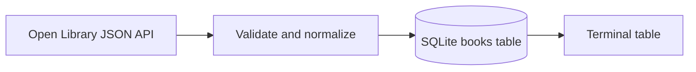
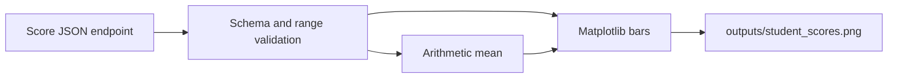
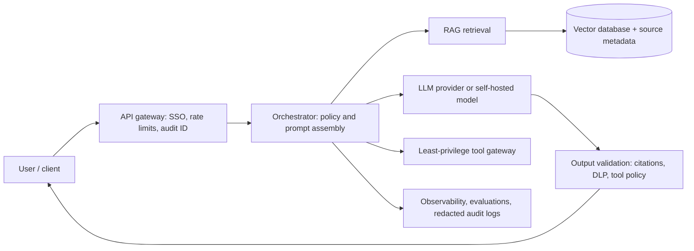

# AccuKnox AI Security Engineer — Take-Home Submission

**Candidate:** Prashant Andoriya  
**Role:** AI Security Engineer Trainee

This repository answers all three assignments and contains runnable, tested Python implementations for Assignment 1. I have documented assumptions rather than presenting them as facts.

## Contents

1. [Assumptions](#assumptions)
2. [Assignment 1 — Python solutions](#assignment-1--python-solutions)
3. [Assignment 2 — LLM, AI/ML and vector databases](#assignment-2--llm-aiml-and-vector-databases)
4. [Assignment 3 — Project I am proud of](#assignment-3--project-i-am-proud-of)

## Assumptions

| Area | Assumption |
| --- | --- |
| Python runtime | Python 3.11+ is available. |
| Book API | The task does not prescribe a provider, so I use Open Library's documented Search API. It returns title, author and first publication year in one response. |
| Student API | No public student-score endpoint or schema is specified. To make the work reproducible, `data/student_scores.json` is served over HTTP locally; the client still retrieves it through an API URL. The URL is configurable for a real API. |
| Score range | Scores are numeric percentages from 0 through 100. Invalid values fail fast instead of changing the average silently. |
| CSV behavior | Email is the natural key. Re-importing an email updates its name, making the import safe to run more than once. |
| Self-ratings | The ratings below are a conservative, evidence-based self-assessment from the projects shared here. They should be updated if there is additional coursework or production experience not included in this submission. |

## Repository structure

```text
accuknox-ai-security-assignment/
├── .github/
│   └── workflows/
│       └── tests.yml                  # Runs the test suite in GitHub Actions
├── data/
│   ├── student_scores.json            # Reproducible HTTP API fixture
│   └── users.csv                      # Sample CSV input
├── outputs/
│   └── .gitkeep                       # Keeps the generated-artifact folder in Git
├── src/
│   ├── __init__.py
│   ├── database.py                    # SQLite connection, schema, transaction helpers
│   ├── books_pipeline.py               # API → validation → SQLite → terminal display
│   ├── scores_pipeline.py              # API → validation → average → PNG bar chart
│   └── csv_to_sqlite.py                # CSV → validation → SQLite upsert
├── tests/
│   ├── test_books_pipeline.py
│   ├── test_scores_pipeline.py
│   └── test_csv_to_sqlite.py
├── .gitignore
├── pytest.ini
├── requirements.txt
└── README.md
```

## Assignment 1 — Python solutions

### Setup

```powershell
git clone https://github.com/andoriyaprashant/accuknox-ai-security-assignment.git
cd accuknox-ai-security-assignment

python -m venv .venv
.\.venv\Scripts\Activate.ps1

python -m pip install --upgrade pip
python -m pip install -r requirements.txt

python -m pytest -q
```

Run the checks:

```powershell
python -m pytest -q
```

The three workflows use explicit validation, timeouts for HTTP calls, parameterized SQL, transactions and idempotent writes. Generated SQLite databases and chart images are intentionally excluded from Git so every reviewer can recreate them.

### 1. API data retrieval and SQLite storage

**Requirement:** fetch a JSON list of books, store title/author/publication year in SQLite and display the retrieved data.

Implementation: [`src/books_pipeline.py`](src/books_pipeline.py) uses Open Library's documented Search API. It requests only the four fields it needs, validates the response and maps Open Library's field names to a stable local schema. Open Library documents `search.json` as a multi-book endpoint and lists `title`, `author_name` and `first_publish_year` in its response format. See the [Open Library Search API documentation](https://openlibrary.org/dev/docs/api/search).

```powershell
python -m src.books_pipeline --query "artificial intelligence" --limit 10
```

Expected behavior:

```text
Saved or updated 10 book(s) in data/books.db.
Title                         | Author                  | Year
------------------------------+-------------------------+-----
Saved or updated 10 book(s) in data\books.db.
Title                                           | Author                                                        | Year
------------------------------------------------+---------------------------------------------------------------+-----
Artificial Intelligence                         | Stuart J. Russell, Peter Norvig                               | 1994
Artificial intelligence                         | Patrick Henry Winston                                         | 1977
Artificial intelligence                         | Elaine A. Rich                                                | 1983
Artificial Intelligence                         | Melanie Mitchell                                              | 2019
Artificial intelligence                         | George F. Luger, LUGER, Stubblefield, William A. Stubblefield | 1992
Artificial Intelligence and Intelligent Systems | N. P. Padhy                                                   | 2005
Artificial Intelligence and Soft Computing      | Leszek Rutkowski                                              | 2012
Black Hat Python                                | Justin Seitz, Tim Arnold                                      | 2014
Core Python Programming                         | R. Nageswara Rao                                              | 2016
Fluent Python                                   | Luciano Ramalho                                               | 2015
Human Compatible                                | Stuart J. Russell                                             | 2019
Learning Python                                 | Mark Lutz, David Ascher                                       | 1999
Life 3.0                                        | Max Tegmark                                                   | 2017
Python For Data Analysis                        | Wes McKinney                                                  | 2012
Understanding Artificial Intelligence           | Henry C. Mishkoff                                             | 1985
```

Data flow:



Design choices:

- `source_key` is unique, so re-running the command upserts records rather than producing duplicates.
- The client identifies itself and uses a timeout. This follows the provider's guidance to use useful, bounded requests and cache results where appropriate.
- The database constraint rejects impossible publication years; missing years remain `NULL`, which preserves the distinction between unknown and zero.

### 2. Student-score processing and bar chart

**Requirement:** fetch student scores from an API, calculate the average and create a bar chart.

The client is [`src/scores_pipeline.py`](src/scores_pipeline.py). Start the included JSON endpoint in one terminal:

```powershell
python -m http.server 8000 --directory data
```

Then, in a second terminal, retrieve the API response and create the chart:

```powershell
python -m src.scores_pipeline --url http://127.0.0.1:8000/student_scores.json
```

Example result:

```text
Fetched 5 student score(s). Average score: 87.20
Saved chart to outputs/student_scores.png
```

The output is a labelled PNG bar chart with an average-score reference line. The data parser rejects empty names, Boolean values masquerading as scores, non-finite numbers and scores outside 0–100. For a production API, only the `--url` needs to change.



### 3. CSV import into SQLite

**Requirement:** read user information from a CSV and insert it into SQLite.

The solution in [`src/csv_to_sqlite.py`](src/csv_to_sqlite.py) accepts a UTF-8 CSV with exactly `name,email` headers. It normalizes whitespace and email casing, validates the input and performs all writes in one transaction.

```powershell
python -m src.csv_to_sqlite --csv data/users.csv --db data/users.db
```

Example result:

```text
Imported or updated 5 user(s) in data/users.db.
```

The SQL uses `?` parameters rather than interpolating CSV values. `email` has a `UNIQUE` constraint and the import uses `ON CONFLICT ... DO UPDATE`, so it is safe to repeat. If a malformed row is found, no partial import is committed.

### Code Links

| Request | Link | Why this link |
| --- | --- | --- |
| Most complex Python code | [DevDocsHub](https://github.com/andoriyaprashant/DevDocsHub) | A Django-based application that brings programming documentation and open source learning resources into one platform. It demonstrates Python web application structure, data modelling, views, templates and database-backed content. |
| Most complex database code | [GoBookstore](https://github.com/andoriyaprashant/GoBookstore) | A Go REST API for book CRUD operations backed by MySQL. It is the most directly relevant database focused repository in my portfolio. |

## Assignment 2 — LLM, AI/ML and vector databases

### Self-assessment

I rated myself A in LLMs and AI and B in deep learning and ML. I am comfortable independently working with LLM APIs, building AI powered application workflows and applying AI concepts to practical problems. In deep learning and machine learning, I understand the fundamentals and can implement solutions with guidance, while continuing to improve my practical experience.

### Key architectural components of an LLM chatbot

I would treat an LLM chatbot as a security-sensitive distributed system, not just a model call. A high-level architecture is below.



1. **User experience and API gateway:** The web/mobile client sends messages to an authenticated backend. The gateway enforces SSO/RBAC, tenant isolation, request limits, schema validation and a correlation ID. Secrets stay server-side.
2. **Orchestrator:** A backend service applies the system policy, conversation state, routing, token/cost limits and safe fallback behavior. It should version prompts and models so an answer can be reproduced and investigated.
3. **Model layer:** Use a hosted or self-hosted model behind a small provider adapter. This decouples the product from one model vendor and makes it possible to apply model-specific safety settings consistently.
4. **Knowledge/RAG layer:** Ingest approved documents, scan/classify them, chunk them with source IDs and permissions, create embeddings and retrieve only documents the current user may access. Return citations with the answer so the user can verify claims.
5. **Tool layer:** If the chatbot can call ticketing, cloud, or security tools, put every tool behind a narrow, allow-listed gateway. The model proposes a structured action; deterministic code validates arguments and authorization before execution. High-impact actions require user confirmation.
6. **Guardrails and data protection:** Treat prompts, retrieved text and tool output as untrusted. Defend in depth with input limits, content classification, prompt-injection testing, output encoding/validation, DLP/redaction, egress controls, encryption and retention limits. OWASP identifies prompt injection as a leading LLM-application risk; a system prompt alone is not a security boundary. See [OWASP's prompt-injection guidance](https://genai.owasp.org/llm2026/llm012026-prompt-injection/).
7. **Observability and evaluation:** Capture redacted traces, latency, cost, retrieval quality, refusal quality, safety-policy violations and user feedback. Before rollout, use offline evaluation sets and adversarial tests; after rollout, monitor drift and run incident response. I would align risk management with the [NIST Generative AI Profile](https://www.nist.gov/publications/artificial-intelligence-risk-management-framework-generative-artificial-intelligence).

The request path is: authenticate user → classify/rate-limit request → retrieve authorized context → construct a bounded prompt → call the model → validate/redact output → require approval for side effects → return answer with citations → log a privacy-aware audit event.

### Vector databases

A vector database stores embeddings: numeric vectors that represent the semantic content of text, images, or other data. A query is embedded using the same model; approximate nearest-neighbour search finds semantically similar vectors. The original content and metadata remain attached as payloads, enabling filters such as `tenant_id`, `document_type`, `classification`, `source` and `valid_from`.

For RAG, vector search is not a replacement for authorization or keyword search. A strong retrieval path typically applies permission filtering first, runs semantic and lexical retrieval, optionally reranks the candidates and returns source citations. Embeddings can leak information and can retrieve irrelevant or maliciously crafted content, so they need the same access controls, retention rules and monitoring as other sensitive indexes.

#### Hypothetical selection: internal cloud-security investigation assistant

**Problem:** Security analysts ask questions over approved runbooks, cloud-alert investigations, detections and post-incident reports. Documents may be confidential and must never cross tenant or classification boundaries. Queries often contain exact terms (CVE IDs, resource names, IAM actions) as well as natural-language descriptions of an incident.

| Option | Strength | Trade-off |
| --- | --- | --- |
| pgvector | Simple choice when the corpus is modest and PostgreSQL is already the system of record. | Search-specific scale/tuning and hybrid retrieval need more application ownership. |
| Managed vector SaaS | Fast operational start and managed scaling. | Requires a vendor/data-residency assessment and may be unsuitable for highly restricted incident data. |
| **Qdrant (selected)** | Can be self-hosted in the security boundary; supports payload filters and hybrid dense/sparse retrieval useful for both CVE identifiers and semantic incident descriptions. | The team owns deployment, upgrades, backups, access controls and evaluation. |

I would choose **self-hosted Qdrant** for this hypothetical system. Its payload filtering supports applying metadata conditions during search, which is useful for enforced tenant and classification scope; its hybrid-query capability can combine semantic retrieval with precise lexical matching. Those features are documented in Qdrant's [filtering documentation](https://qdrant.tech/documentation/search/filtering/) and [hybrid-query documentation](https://qdrant.tech/documentation/hybrid-queries/).

Selection is still an engineering decision, not a default. I would benchmark recall/latency/cost with real, permission-filtered evaluation queries; validate cross-tenant isolation; encrypt data in transit and at rest; use least-privilege service identities; and compare Qdrant with pgvector if the corpus remains small and PostgreSQL is already governed well.

## Assignment 3 — Project I am proud of

### [OpSo](https://github.com/andoriyaprashant/OpSo)

OpSo is a Flutter application that helps users discover open-source programs and their projects, eligibility information and resources.

**Why it is hard (three lines):**

1. There is no centralized API for the open-source programs, so collecting information across program websites requires handling different structures, update schedules and source quality.
2. The data must be normalized into consistent JSON across organizations and years while retaining provenance and gracefully handling incomplete or changed information.
3. The Flutter application must turn that evolving dataset into an understandable, cross-platform experience without breaking existing program/year views.

The part I am especially proud of is the data pipeline and its product impact: converting disparate, year-specific program and project information into structured JSON the app can render consistently. For a production version, I would make each source explicit, honor terms/rate limits add validation and freshness checks and retain source URLs/timestamps for every record.

## Code links

## Project I am proud of

[OpSo](https://github.com/andoriyaprashant/OpSo) — Flutter app for discovering open source programs; its difficult part is normalizing decentralized, time varying program data.
